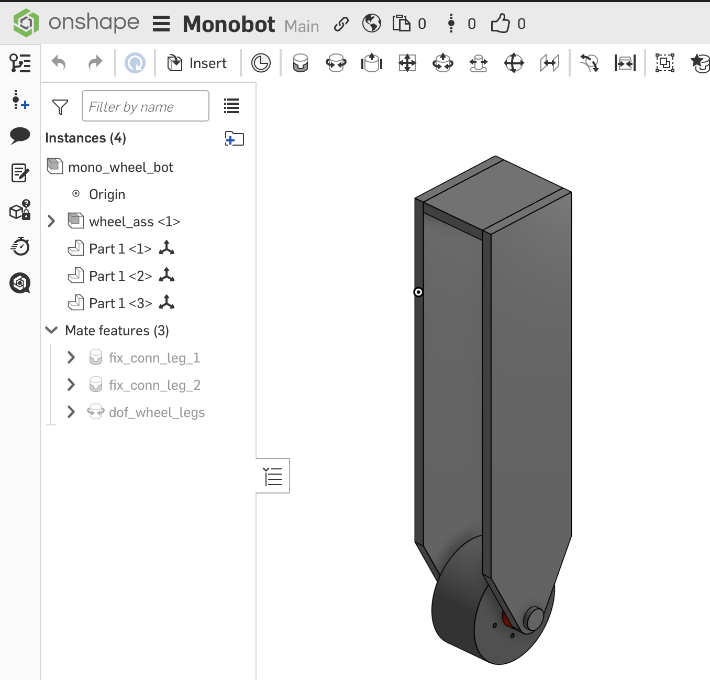
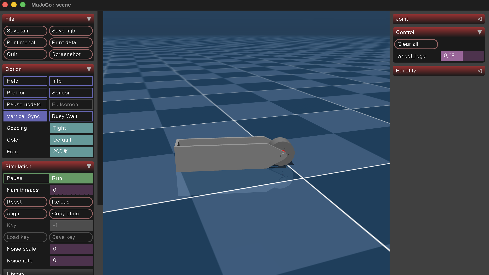

Most tutorials explain how to control joint positions in Mujoco. This post covers implementing velocity control instead. I designed my robot model in Onshape and used the [Onshape to robot package](https://github.com/Rhoban/onshape-to-robot) to convert the CAD assembly to Mujoco XML.

After creating the assembly in Onshape, name the fixed joints as "fix_*" and movable joints as "dof_*". Right-click the mates under "Mate features" to rename them. I named my wheel joint "dof_wheel_legs"—this is the joint I want to control with velocity.



Assign material properties to all parts for accurate physics simulation. Copy your assembly's URL.

Install the [Onshape to robot package](https://github.com/Rhoban/onshape-to-robot) and create an API key. Follow [these](https://onshape-to-robot.readthedocs.io/en/latest/getting_started.html#setting-up-your-authentication) steps to set up authentication.

Create a new directory with the following `config.json` file:
```json
{
    "url": "<assembly_url>",
    "output_format": "mujoco",
    "joint_properties": {
        "wheel_legs": {
            "type": "velocity",
            "range": false,
	    "kv": 5
        }
    }
}
```

The `joint_properties` above enable velocity control of the `wheel_legs` joint. Drag and drop the generated `scene.xml` file into Mujoco, then set the joint velocity using the "Control" sidebar.



> [!CAUTION]
> When converting a pickle file to Mujoco XML, joint properties are baked into the pickle file. If you edit `joint_properties` in config.json after retrieving the file, the changes won't be reflected in the XML. See [#206](https://github.com/Rhoban/onshape-to-robot/issues/206). Delete the pickle file and re-fetch the model for changes to take effect. 
